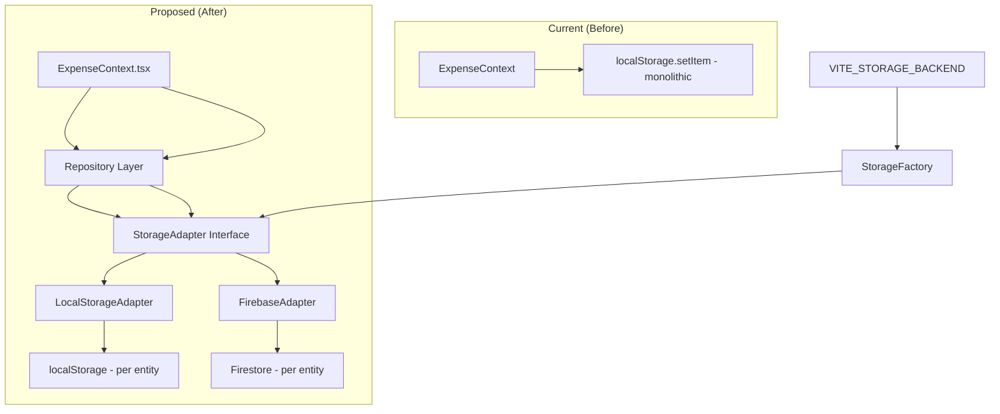
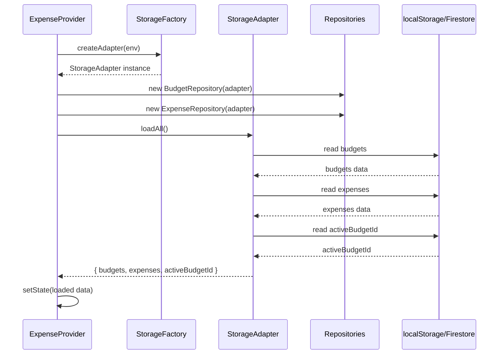
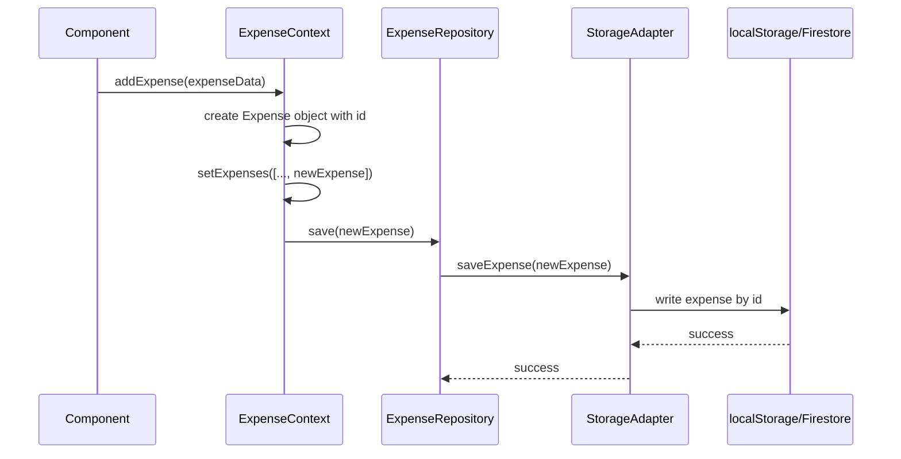
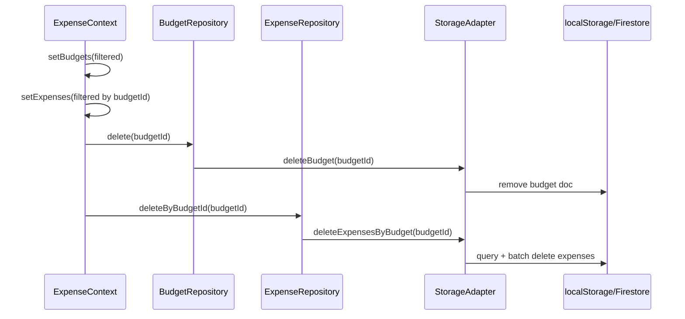

# Design Document: Storage Backend Abstraction

## Overview

Este design descreve a abstração da camada de persistência do Expense Tracker, substituindo o acesso direto ao `localStorage` por uma arquitetura em camadas que permite alternar entre `localStorage` e Firebase Firestore através de uma variável de ambiente. A motivação principal é tornar o armazenamento robusto, permitindo sincronização na nuvem sem acoplar o contexto React a uma tecnologia específica de persistência.

A arquitetura utiliza o padrão Strategy (Adapter) para definir um contrato comum de operações de armazenamento, com duas implementações concretas: `LocalStorageAdapter` (mantém compatibilidade com o formato atual) e `FirebaseAdapter` (usa Firestore com operações assíncronas). Uma fábrica (`StorageFactory`) seleciona a implementação com base na variável de ambiente `VITE_STORAGE_BACKEND`.

A mudança central é a transição de um salvamento monolítico (um único JSON blob) para operações por entidade (budgets, expenses, activeBudgetId), permitindo granularidade na persistência e preparando o caminho para sincronização em tempo real e multi-usuário no futuro.

## Architecture



### Camadas de Responsabilidade

| Camada | Responsabilidade |
|--------|-----------------|
| `ExpenseContext` | Gerencia estado React, delega persistência aos repositórios |
| `Repository` (BudgetRepository, ExpenseRepository) | Operações CRUD por entidade, usa o StorageAdapter |
| `StorageAdapter` (interface) | Contrato comum: operações async de get/save/delete/load |
| `LocalStorageAdapter` | Implementa o contrato usando localStorage (síncrono wrapped em Promise) |
| `FirebaseAdapter` | Implementa o contrato usando Firestore (assíncrono nativo) |
| `StorageFactory` | Cria o adapter correto com base em `VITE_STORAGE_BACKEND` |

## Sequence Diagrams

### Fluxo: Inicialização da Aplicação



### Fluxo: Adicionar Despesa



### Fluxo: Deletar Budget (com cascade)



## Components and Interfaces

### Component 1: StorageAdapter (Interface)

**Purpose**: Define o contrato comum para todas as implementações de armazenamento.

```typescript
interface StorageAdapter {
  // Budget operations
  loadBudgets(): Promise<BudgetGoal[]>;
  saveBudget(budget: BudgetGoal): Promise<void>;
  deleteBudget(budgetId: string): Promise<void>;

  // Expense operations
  loadExpenses(): Promise<Expense[]>;
  saveExpense(expense: Expense): Promise<void>;
  updateExpense(expense: Expense): Promise<void>;
  deleteExpense(expenseId: string): Promise<void>;
  deleteExpensesByBudget(budgetId: string): Promise<void>;

  // Metadata
  getActiveBudgetId(): Promise<string | null>;
  setActiveBudgetId(budgetId: string): Promise<void>;

  // Bulk operations (for import)
  loadAll(): Promise<StorageData>;
  saveAll(data: StorageData): Promise<void>;
}
```

**Responsibilities**:
- Prover operações CRUD por entidade
- Garantir que todas as operações sejam assíncronas (Promise)
- Abstrair detalhes de implementação do storage específico

### Component 2: LocalStorageAdapter

**Purpose**: Implementa o StorageAdapter usando localStorage, mantendo compatibilidade com o formato existente.

```typescript
class LocalStorageAdapter implements StorageAdapter {
  private readonly STORAGE_KEY = 'expense_tracker_data_v2';

  async loadBudgets(): Promise<BudgetGoal[]> { /* ... */ }
  async saveBudget(budget: BudgetGoal): Promise<void> { /* ... */ }
  async deleteBudget(budgetId: string): Promise<void> { /* ... */ }
  async loadExpenses(): Promise<Expense[]> { /* ... */ }
  async saveExpense(expense: Expense): Promise<void> { /* ... */ }
  async updateExpense(expense: Expense): Promise<void> { /* ... */ }
  async deleteExpense(expenseId: string): Promise<void> { /* ... */ }
  async deleteExpensesByBudget(budgetId: string): Promise<void> { /* ... */ }
  async getActiveBudgetId(): Promise<string | null> { /* ... */ }
  async setActiveBudgetId(budgetId: string): Promise<void> { /* ... */ }
  async loadAll(): Promise<StorageData> { /* ... */ }
  async saveAll(data: StorageData): Promise<void> { /* ... */ }
}
```

**Responsibilities**:
- Ler/escrever no localStorage mantendo o formato JSON atual
- Operações individuais atualizam apenas a parte relevante do JSON
- Wrapping síncrono em Promises para compatibilidade de interface

### Component 3: FirebaseAdapter

**Purpose**: Implementa o StorageAdapter usando Firebase Firestore.

```typescript
class FirebaseAdapter implements StorageAdapter {
  private db: Firestore;
  private collectionPrefix: string; // e.g., 'users/{uid}/' if auth present

  async loadBudgets(): Promise<BudgetGoal[]> { /* Firestore query */ }
  async saveBudget(budget: BudgetGoal): Promise<void> { /* setDoc */ }
  async deleteBudget(budgetId: string): Promise<void> { /* deleteDoc */ }
  async loadExpenses(): Promise<Expense[]> { /* Firestore query */ }
  async saveExpense(expense: Expense): Promise<void> { /* setDoc */ }
  async updateExpense(expense: Expense): Promise<void> { /* setDoc (merge) */ }
  async deleteExpense(expenseId: string): Promise<void> { /* deleteDoc */ }
  async deleteExpensesByBudget(budgetId: string): Promise<void> { /* query + batch */ }
  async getActiveBudgetId(): Promise<string | null> { /* getDoc metadata */ }
  async setActiveBudgetId(budgetId: string): Promise<void> { /* setDoc metadata */ }
  async loadAll(): Promise<StorageData> { /* loadBudgets + loadExpenses + getActiveBudgetId */ }
  async saveAll(data: StorageData): Promise<void> { /* batch write */ }
}
```

**Responsibilities**:
- Mapear entidades para documentos Firestore
- Gerenciar coleções: `budgets`, `expenses`, `metadata`
- Suportar prefixo de usuário para escopo de dados (se auth presente)
- Tratar erros de rede e reconnect do Firestore

### Component 4: StorageFactory

**Purpose**: Cria o adapter apropriado com base na variável de ambiente.

```typescript
class StorageFactory {
  static create(): StorageAdapter {
    const backend = import.meta.env.VITE_STORAGE_BACKEND || 'local';

    switch (backend) {
      case 'firebase':
        return new FirebaseAdapter();
      case 'local':
      default:
        return new LocalStorageAdapter();
    }
  }
}
```

**Responsibilities**:
- Ler variável de ambiente `VITE_STORAGE_BACKEND`
- Instanciar o adapter correto
- Prover fallback para `local` se variável não definida

### Component 5: BudgetRepository

**Purpose**: Encapsula operações de domínio para budgets.

```typescript
class BudgetRepository {
  constructor(private adapter: StorageAdapter) {}

  async getAll(): Promise<BudgetGoal[]> { return this.adapter.loadBudgets(); }
  async save(budget: BudgetGoal): Promise<void> { return this.adapter.saveBudget(budget); }
  async delete(budgetId: string): Promise<void> { return this.adapter.deleteBudget(budgetId); }
  async saveAll(budgets: BudgetGoal[]): Promise<void> { /* batch via adapter.saveBudget */ }
}
```

### Component 6: ExpenseRepository

**Purpose**: Encapsula operações de domínio para expenses.

```typescript
class ExpenseRepository {
  constructor(private adapter: StorageAdapter) {}

  async getAll(): Promise<Expense[]> { return this.adapter.loadExpenses(); }
  async save(expense: Expense): Promise<void> { return this.adapter.saveExpense(expense); }
  async update(expense: Expense): Promise<void> { return this.adapter.updateExpense(expense); }
  async delete(expenseId: string): Promise<void> { return this.adapter.deleteExpense(expenseId); }
  async deleteByBudgetId(budgetId: string): Promise<void> { return this.adapter.deleteExpensesByBudget(budgetId); }
}
```

## Data Models

### Model 1: Expense

```typescript
interface Expense {
  id: string;            // Unique identifier (Date.now().toString() currently, should migrate to nanoid)
  amount: number;       // Positive number, the expense value
  description: string;   // Non-empty string, human-readable description
  date: string;          // ISO date string (YYYY-MM-DD)
  category: string;      // Non-empty string, category name
  budgetId: string;      // References BudgetGoal.id
  isEssential: boolean;  // Flag for essential expenses
}
```

**Validation Rules**:
- `id` must be non-empty string
- `amount` must be a positive number (> 0)
- `description` must be non-empty string
- `date` must be valid ISO date string
- `category` must be non-empty string
- `budgetId` must reference an existing BudgetGoal.id

### Model 2: BudgetGoal

```typescript
interface BudgetGoal {
  id: string;                          // Unique identifier
  name: string;                        // Non-empty string
  totalAmount: number;                 // Positive number
  startDate: string;                    // ISO date string
  endDate: string;                      // ISO date string (must be after startDate)
  initialSpent?: number;                // Optional, non-negative number
  categoryLimits?: CategoryLimit[];    // Optional array of category limits
}
```

**Validation Rules**:
- `id` must be non-empty string
- `name` must be non-empty string
- `totalAmount` must be a positive number
- `startDate` must be valid ISO date string
- `endDate` must be valid ISO date string and after `startDate`
- `initialSpent` (if present) must be non-negative
- `categoryLimits` (if present) must have unique `category` values

### Model 3: CategoryLimit

```typescript
interface CategoryLimit {
  category: string;     // Non-empty string, category name
  maxAmount: number;    // Positive number, maximum allowed for this category
}
```

**Validation Rules**:
- `category` must be non-empty string
- `maxAmount` must be a positive number

### Model 4: StorageData

```typescript
interface StorageData {
  budgets: BudgetGoal[];
  expenses: Expense[];
  activeBudgetId: string | null;
}
```

### Firestore Document Mapping

| Entity | Collection Path | Document ID |
|--------|-----------------|-------------|
| BudgetGoal | `budgets` | `{budgetId}` |
| Expense | `expenses` | `{expenseId}` |
| Active Budget | `metadata` | `activeBudget` |

## Algorithmic Pseudocode

### Algorithm 1: Initialize Storage Adapter

```pascal
ALGORITHM createStorageAdapter()
OUTPUT: adapter of type StorageAdapter

BEGIN
  backend ← import.meta.env.VITE_STORAGE_BACKEND
  
  IF backend EQUALS "firebase" THEN
    ASSERT firebaseConfig is valid (apiKey, projectId present)
    adapter ← new FirebaseAdapter(firebaseConfig)
  ELSE IF backend EQUALS "local" OR backend is undefined THEN
    adapter ← new LocalStorageAdapter()
  ELSE
    THROW Error("Unknown storage backend: " + backend)
  END IF
  
  RETURN adapter
END
```

**Preconditions:**
- Environment variables are loaded by Vite
- If backend is "firebase", Firebase configuration variables must be present

**Postconditions:**
- Returns a valid StorageAdapter instance
- The adapter is ready for use (connected to storage)

### Algorithm 2: Load All Data on Mount

```pascal
ALGORITHM loadInitialData(adapter, budgetRepo, expenseRepo)
INPUT: adapter (StorageAdapter), budgetRepo (BudgetRepository), expenseRepo (ExpenseRepository)
OUTPUT: data of type StorageData

BEGIN
  ASSERT adapter IS NOT NULL
  
  // Step 1: Load all budgets
  budgets ← AWAIT budgetRepo.getAll()
  ASSERT budgets IS Array
  
  // Step 2: Load all expenses
  expenses ← AWAIT expenseRepo.getAll()
  ASSERT expenses IS Array
  
  // Step 3: Load active budget ID
  activeBudgetId ← AWAIT adapter.getActiveBudgetId()
  
  // Step 4: Validate activeBudgetId references existing budget
  IF activeBudgetId IS NOT NULL AND budgets DOES NOT CONTAIN budget WITH id = activeBudgetId THEN
    IF budgets.length > 0 THEN
      activeBudgetId ← budgets[0].id
    ELSE
      activeBudgetId ← NULL
    END IF
  END IF
  
  // Step 5: If no active budget but budgets exist, select first
  IF activeBudgetId IS NULL AND budgets.length > 0 THEN
    activeBudgetId ← budgets[0].id
  END IF
  
  data ← { budgets, expenses, activeBudgetId }
  
  ASSERT data.budgets IS Array
  ASSERT data.expenses IS Array
  ASSERT data.activeBudgetId IS NULL OR references existing budget
  
  RETURN data
END
```

**Preconditions:**
- adapter is initialized and connected
- budgetRepo and expenseRepo use the same adapter

**Postconditions:**
- Returns StorageData with all entities loaded
- activeBudgetId is null OR references an existing budget

**Loop Invariants:** N/A (no loops)

### Algorithm 3: Save Budget (Create or Update)

```pascal
ALGORITHM saveBudget(goal, budgets, budgetRepo)
INPUT: goal (BudgetGoal without id), budgets (current BudgetGoal[]), budgetRepo (BudgetRepository)
OUTPUT: newBudget of type BudgetGoal, updatedBudgets of type BudgetGoal[]

BEGIN
  ASSERT goal.name IS NOT EMPTY
  ASSERT goal.totalAmount > 0
  ASSERT goal.endDate > goal.startDate
  
  // Generate unique ID
  newBudget ← { ...goal, id: generateUniqueId() }
  
  // Update local state
  updatedBudgets ← [...budgets, newBudget]
  
  // Persist to storage
  AWAIT budgetRepo.save(newBudget)
  
  ASSERT updatedBudgets CONTAINS newBudget
  ASSERT newBudget.id IS NOT EMPTY
  
  RETURN newBudget, updatedBudgets
END
```

**Preconditions:**
- goal.name is non-empty
- goal.totalAmount is positive
- goal.endDate is after goal.startDate
- budgetRepo is initialized

**Postconditions:**
- newBudget has a unique id
- newBudget is persisted in storage
- updatedBudgets contains newBudget

### Algorithm 4: Delete Budget with Cascade

```pascal
ALGORITHM deleteBudgetWithCascade(budgetId, budgets, expenses, budgetRepo, expenseRepo)
INPUT: budgetId (string), budgets (BudgetGoal[]), expenses (Expense[]), budgetRepo, expenseRepo
OUTPUT: updatedBudgets, updatedExpenses, newActiveBudgetId

BEGIN
  ASSERT budgetId IS NOT EMPTY
  ASSERT budgets CONTAINS budget WITH id = budgetId
  
  // Step 1: Filter out the budget
  updatedBudgets ← budgets FILTER WHERE b.id ≠ budgetId
  
  // Step 2: Cascade delete expenses belonging to this budget
  updatedExpenses ← expenses FILTER WHERE e.budgetId ≠ budgetId
  
  // Step 3: Persist deletions
  AWAIT budgetRepo.delete(budgetId)
  AWAIT expenseRepo.deleteByBudgetId(budgetId)
  
  // Step 4: Handle active budget ID
  IF activeBudgetId EQUALS budgetId THEN
    IF updatedBudgets.length > 0 THEN
      newActiveBudgetId ← updatedBudgets[0].id
    ELSE
      newActiveBudgetId ← NULL
    END IF
  ELSE
    newActiveBudgetId ← activeBudgetId
  END IF
  
  // Step 5: Persist new active budget ID if changed
  IF newActiveBudgetId ≠ activeBudgetId THEN
    AWAIT adapter.setActiveBudgetId(newActiveBudgetId)
  END IF
  
  ASSERT updatedBudgets DOES NOT CONTAIN budget WITH id = budgetId
  ASSERT updatedExpenses DOES NOT CONTAIN expense WITH budgetId = budgetId
  
  RETURN updatedBudgets, updatedExpenses, newActiveBudgetId
END
```

**Preconditions:**
- budgetId is non-empty
- A budget with budgetId exists in budgets

**Postconditions:**
- Budget with budgetId is removed from storage
- All expenses with budgetId are removed from storage
- activeBudgetId is updated if it referenced the deleted budget
- No orphaned expenses remain (all expenses.budgetId reference existing budgets)

**Loop Invariants:** N/A (filter operations, no explicit loops)

### Algorithm 5: Delete Expenses by Budget ID (Firestore Batch)

```pascal
ALGORITHM deleteExpensesByBudget(budgetId, adapter)
INPUT: budgetId (string), adapter (StorageAdapter)
OUTPUT: deletedCount of type number

BEGIN
  ASSERT budgetId IS NOT EMPTY
  
  // Step 1: Query all expenses with this budgetId
  expensesToDelete ← AWAIT adapter.loadExpenses()
  expensesToDelete ← expensesToDelete FILTER WHERE e.budgetId = budgetId
  
  ASSERT ALL expenses in expensesToDelete have budgetId = budgetId
  
  // Step 2: Batch delete
  deletedCount ← 0
  FOR each expense IN expensesToDelete DO
    ASSERT expense.budgetId = budgetId  // loop invariant
    AWAIT adapter.deleteExpense(expense.id)
    deletedCount ← deletedCount + 1
  END FOR
  
  ASSERT deletedCount = expensesToDelete.length
  
  RETURN deletedCount
END
```

**Preconditions:**
- budgetId is non-empty
- adapter is connected and functional

**Postconditions:**
- All expenses with budgetId are deleted from storage
- No expenses with budgetId remain in storage
- deletedCount equals the number of expenses that had budgetId

**Loop Invariants:**
- All previously deleted expenses had budgetId matching the input
- deletedCount equals the number of iterations completed

## Key Functions with Formal Specifications

### Function: addExpense()

```typescript
async function addExpense(
  expense: Omit<Expense, 'id' | 'budgetId'>,
  activeBudgetId: string | null,
  expenseRepo: ExpenseRepository
): Promise<Expense>
```

**Preconditions:**
- `activeBudgetId` is not null (there is an active budget)
- `expense.amount` is a positive number
- `expense.description` is non-empty
- `expense.date` is a valid ISO date string
- `expenseRepo` is initialized

**Postconditions:**
- Returns an Expense with a unique `id` and `budgetId` = `activeBudgetId`
- The new expense is persisted to storage
- No existing expenses are modified

### Function: updateExpense()

```typescript
async function updateExpense(
  id: string,
  updatedExpense: Omit<Expense, 'id' | 'budgetId'>,
  expenseRepo: ExpenseRepository
): Promise<void>
```

**Preconditions:**
- `id` is non-empty and references an existing expense
- `updatedExpense` fields pass validation

**Postconditions:**
- The expense with `id` has its fields updated
- The `id` and `budgetId` fields are preserved (not changed)
- The update is persisted to storage
- All other expenses remain unchanged

### Function: setBudgetGoal()

```typescript
async function setBudgetGoal(
  goal: Omit<BudgetGoal, 'id'>,
  budgetRepo: BudgetRepository
): Promise<BudgetGoal>
```

**Preconditions:**
- `goal.name` is non-empty
- `goal.totalAmount` is positive
- `goal.endDate` is after `goal.startDate`
- `budgetRepo` is initialized

**Postconditions:**
- Returns a BudgetGoal with a unique `id`
- The new budget is persisted to storage
- The new budget becomes the active budget

### Function: setCategoryLimit()

```typescript
async function setCategoryLimit(
  category: string,
  maxAmount: number,
  activeBudget: BudgetGoal | null,
  budgetRepo: BudgetRepository
): Promise<BudgetGoal[]>
```

**Preconditions:**
- `activeBudget` is not null
- `category` is non-empty
- `maxAmount` is positive
- `budgetRepo` is initialized

**Postconditions:**
- The active budget's `categoryLimits` array contains the category with the specified `maxAmount`
- If the category already existed, its `maxAmount` is updated
- If the category is new, it is appended to `categoryLimits`
- The update is persisted to storage

## Example Usage

### Initialization no ExpenseProvider

```typescript
import { StorageFactory } from '@/storage/StorageFactory';
import { BudgetRepository } from '@/storage/BudgetRepository';
import { ExpenseRepository } from '@/storage/ExpenseRepository';

export const ExpenseProvider: React.FC<{ children: ReactNode }> = ({ children }) => {
  const [budgets, setBudgets] = useState<BudgetGoal[]>([]);
  const [expenses, setExpenses] = useState<Expense[]>([]);
  const [activeBudgetId, setActiveBudgetId] = useState<string | null>(null);
  const [isLoaded, setIsLoaded] = useState(false);

  // Create adapter and repositories once
  const adapter = useMemo(() => StorageFactory.create(), []);
  const budgetRepo = useMemo(() => new BudgetRepository(adapter), [adapter]);
  const expenseRepo = useMemo(() => new ExpenseRepository(adapter), [adapter]);

  // Load on mount
  useEffect(() => {
    (async () => {
      const data = await adapter.loadAll();
      setBudgets(data.budgets);
      setExpenses(data.expenses);
      const activeId = data.activeBudgetId || data.budgets[0]?.id || null;
      setActiveBudgetId(activeId);
      setIsLoaded(true);
    })();
  }, [adapter]);

  // Save budget
  const setBudgetGoal = async (goal: Omit<BudgetGoal, 'id'>) => {
    const newBudget: BudgetGoal = { ...goal, id: Date.now().toString() };
    setBudgets(prev => [...prev, newBudget]);
    setActiveBudgetId(newBudget.id);
    await budgetRepo.save(newBudget);
  };

  // Add expense
  const addExpense = async (expense: Omit<Expense, 'id' | 'budgetId'>) => {
    if (!activeBudgetId) return;
    const newExpense: Expense = { ...expense, id: Date.now().toString(), budgetId: activeBudgetId };
    setExpenses(prev => [...prev, newExpense]);
    await expenseRepo.save(newExpense);
  };

  // Delete budget with cascade
  const deleteBudget = async (budgetId: string) => {
    setBudgets(prev => prev.filter(b => b.id !== budgetId));
    setExpenses(prev => prev.filter(e => e.budgetId !== budgetId));
    await budgetRepo.delete(budgetId);
    await expenseRepo.deleteByBudgetId(budgetId);
    if (activeBudgetId === budgetId) {
      const remaining = budgets.filter(b => b.id !== budgetId);
      const newActiveId = remaining.length > 0 ? remaining[0].id : null;
      setActiveBudgetId(newActiveId);
      await adapter.setActiveBudgetId(newActiveId);
    }
  };

  // ... rest of context
};
```

### Variáveis de Ambiente (.env)

```bash
# Storage backend selection: "local" or "firebase"
VITE_STORAGE_BACKEND=local

# Firebase configuration (only needed when VITE_STORAGE_BACKEND=firebase)
VITE_FIREBASE_API_KEY=your-api-key
VITE_FIREBASE_AUTH_DOMAIN=your-project.firebaseapp.com
VITE_FIREBASE_PROJECT_ID=your-project-id
VITE_FIREBASE_STORAGE_BUCKET=your-project.appspot.com
VITE_FIREBASE_MESSAGING_SENDER_ID=your-sender-id
VITE_FIREBASE_APP_ID=your-app-id
```

### Migração de Dados (localStorage → Firebase)

```typescript
async function migrateFromLocalToFirebase(): Promise<void> {
  // 1. Load all data from localStorage
  const localAdapter = new LocalStorageAdapter();
  const data = await localAdapter.loadAll();

  // 2. Save all data to Firebase
  const firebaseAdapter = new FirebaseAdapter();
  await firebaseAdapter.saveAll(data);

  console.log('Migration complete');
}
```

## Correctness Properties

### Property 1: Referential Integrity

```text
∀ expense ∈ expenses: ∃ budget ∈ budgets: expense.budgetId = budget.id
```

Após qualquer operação, toda despesa deve referenciar um budget existente. Ao deletar um budget, todas as despesas associadas também são deletadas.
**Validates:** Requirements 10.1, 10.4

### Property 2: Active Budget Validity

```text
activeBudgetId = null ∨ ∃ budget ∈ budgets: budget.id = activeBudgetId
```

O `activeBudgetId` é sempre `null` ou referencia um budget que existe na lista de budgets.
**Validates:** Requirements 10.2, 10.3

### Property 3: Storage Consistency

```text
∀ operation op: after op completes, storage state = React state
```

Após qualquer operação de escrita ser completada (Promise resolved), o estado no storage reflete o estado do React. Não há divergência entre o que está na memória e o que está persistido.
**Validates:** Requirements 13.1, 13.2, 13.3

### Property 4: Budget Validation

```text
∀ budget ∈ budgets: budget.totalAmount > 0 ∧ budget.endDate > budget.startDate
```

Todo budget tem totalAmount positivo e endDate posterior a startDate.
**Validates:** Requirements 11.1, 11.4

### Property 5: Expense Validation

```text
∀ expense ∈ expenses: expense.amount > 0 ∧ expense.description ≠ "" ∧ expense.date is valid
```

Toda despesa tem valor positivo, descrição não vazia e data válida.
**Validates:** Requirements 11.2

### Property 6: Category Limit Uniqueness

```text
∀ budget ∈ budgets: ∀ cl1, cl2 ∈ budget.categoryLimits: cl1.category = cl2.category ⟹ cl1 = cl2
```

Dentro de um mesmo budget, não há dois CategoryLimits com a mesma categoria.

### Property 7: ID Uniqueness

```text
∀ b1, b2 ∈ budgets: b1.id = b2.id ⟹ b1 = b2
∀ e1, e2 ∈ expenses: e1.id = e2.id ⟹ e1 = e2
```

Todos os IDs de budgets são únicos entre si. Todos os IDs de expenses são únicos entre si.

### Property 8: Adapter Interchangeability

```text
∀ adapter ∈ {LocalStorageAdapter, FirebaseAdapter}:
  loadAll() returns same entity shapes
  save(e) followed by loadAll() includes e
  delete(id) followed by loadAll() excludes entity with id
```

Qualquer implementação de StorageAdapter deve respeitar o contrato: salvar e depois carregar retorna a entidade; deletar e depois carregar não retorna a entidade.

## Error Handling

### Error Scenario 1: Falha de Conexão com Firebase

**Condition**: Operação de escrita falha devido a erro de rede ou Firebase indisponível.
**Response**: A função `save*` rejeita a Promise com erro descritivo. O contexto captura o erro e exibe notificação ao usuário (via `sonner` toast).
**Recovery**: O estado local do React permanece atualizado (optimistic update). O usuário pode tentar novamente. Implementar retry com backoff exponencial para operações de escrita.

### Error Scenario 2: Dados Corrompidos no localStorage

**Condition**: `JSON.parse` falha ao carregar dados do localStorage.
**Response**: O `LocalStorageAdapter` captura o erro, loga no console, e retorna dados vazios (`{ budgets: [], expenses: [], activeBudgetId: null }`).
**Recovery**: A aplicação inicia em estado limpo. Os dados corrompidos permanecem no localStorage para análise manual.

### Error Scenario 3: Permissão Negada no Firestore

**Condition**: Regras de segurança do Firestore bloqueiam leitura/escrita.
**Response**: A operação rejeita com erro de permissão. O contexto exibe mensagem "Sem permissão para acessar os dados".
**Recovery**: Verificar regras de segurança do Firestore. O usuário pode precisar reautenticar.

### Error Scenario 4: ID Duplicado ao Salvar

**Condition**: `Date.now().toString()` gera ID duplicado (raro, mas possível em salvamentos rápidos).
**Response**: O adapter Firebase sobrescreve o documento existente (comportamento de `setDoc`). O adapter localStorage atualiza o item no array.
**Recovery**: Migrar geração de ID para `nanoid` (já é dependência do projeto) para garantir unicidade.

### Error Scenario 5: Importação de Dados Inválidos

**Condition**: Arquivo JSON importado não tem a estrutura esperada (`budgets` ou `expenses` não são arrays).
**Response**: A função `importData` rejeita com erro "Formato de arquivo inválido".
**Recovery**: O usuário deve fornecer um arquivo válido exportado pela aplicação. Nenhum dado é modificado.

## Testing Strategy

### Unit Testing Approach

Testar cada adapter isoladamente usando vitest:

- **LocalStorageAdapter**: Mock `localStorage` global, testar cada método CRUD, validar formato JSON salvo.
- **FirebaseAdapter**: Mock Firestore (usando `firebase/firestore` mocks ou emulated Firestore), testar cada método CRUD.
- **StorageFactory**: Testar seleção de adapter com diferentes valores de `VITE_STORAGE_BACKEND`.
- **Repositories**: Testar delegação correta para o adapter.

**Cobertura-alvo**: 90%+ para a camada de storage.

### Property-Based Testing Approach

Usar `fast-check` para gerar dados aleatórios válidos e testar propriedades:

**Property Test Library**: fast-check

**Properties to test**:
1. **Round-trip**: Para qualquer `StorageData` válido, `saveAll(data)` seguido de `loadAll()` retorna dados equivalentes.
2. **Delete consistency**: Após `deleteBudget(id)`, `loadBudgets()` não contém o budget e `loadExpenses()` não contém expenses com aquele budgetId.
3. **Adapter equivalence**: Para os mesmos dados, `LocalStorageAdapter` e `FirebaseAdapter` (emulated) produzem resultados equivalentes.
4. **Category limit idempotency**: `setCategoryLimit(cat, amount)` chamado múiplas vezes com mesma categoria mantém apenas um entry.

### Integration Testing Approach

- **ExpenseContext + LocalStorageAdapter**: Renderizar o provider, realizar operações (add/update/delete), desmontar, remontar e verificar que os dados persistem.
- **ExpenseContext + FirebaseAdapter (emulated)**: Usar Firebase Emulator Suite para testar integração real com Firestore sem custo.
- **Migration test**: Carregar dados do localStorage, migrar para Firebase emulated, verificar integridade.

## Performance Considerations

- **Debounce de escritas**: Operações de escrita ao Firestore devem ser debounced (300-500ms) para evitar custos excessivos de escrita, especialmente no useEffect que salva em cada mudança de estado.
- **Batch writes**: Ao importar dados ou migrar, usar `writeBatch` do Firestore para operações atômicas e eficientes.
- **Lazy loading**: Para conjuntos grandes de expenses, considerar paginação ou carregamento sob demanda por budget.
- **Optimistic updates**: O contexto atualiza o estado React imediatamente e persiste em background, mantendo a UI responsiva.
- **Cache local**: O `FirebaseAdapter` pode manter um cache em memória dos dados carregados para evitar queries desnecessárias.

## Security Considerations

- **Firestore Security Rules**: Configurar regras para garantir que apenas usuários autenticados acessem seus próprios dados:
  ```
  match /budgets/{budgetId} {
    allow read, write: if request.auth != null && request.auth.uid == resource.data.userId;
  }
  ```
- **Variáveis de ambiente**: As credenciais do Firebase (apiKey, etc.) são expostas no bundle do cliente por design (Firebase usa security rules, não secret keys, para proteção). Documentar isso claramente.
- **Validação de input**: Todos os dados importados devem ser validados antes de salvar (estrutura, tipos, valores).
- **Sanitização**: Garantir que strings de description e category não contenham scripts (XSS prevention via React default escaping).

## Dependencies

### Novas Dependências (a adicionar)

| Pacote | Versão | Purpose |
|--------|--------|---------|
| `firebase` | `^10.x` | SDK do Firebase para Firestore |

### Dependências Existentes (já no projeto)

| Pacote | Purpose |
|--------|---------|
| `react` | Framework UI |
| `vitest` | Test runner |
| `nanoid` | Geração de IDs únicos (recomendado para substituir Date.now()) |
| `axios` | HTTP client (já presente, pode não ser necessário para Firebase) |
| `zod` | Validação de schemas (já presente, usar para validar dados importados) |

### Estrutura de Diretórios Proposta

```
client/src/
  storage/
    StorageAdapter.ts       # Interface
    LocalStorageAdapter.ts  # Implementação localStorage
    FirebaseAdapter.ts      # Implementação Firebase
    StorageFactory.ts       # Factory
    BudgetRepository.ts     # Repository de budgets
    ExpenseRepository.ts    # Repository de expenses
    types.ts                # StorageData e tipos compartilhados
  contexts/
    ExpenseContext.tsx      # Contexto atualizado (usa repositories)
```
