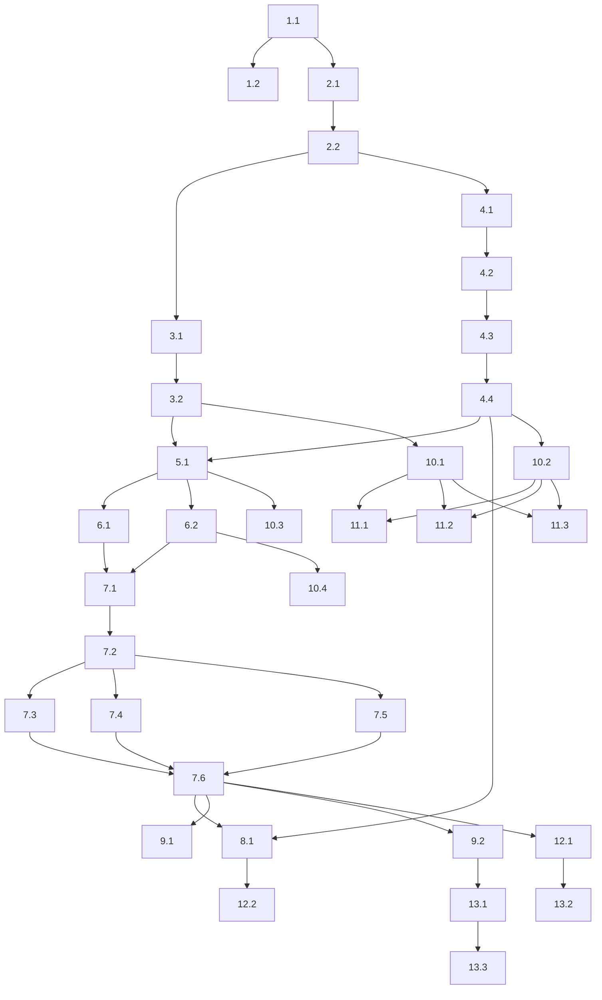

# Implementation Plan: Storage Backend Abstraction

## Overview

Este plano de implementação cobre a criação de uma camada de abstração de persistência para o Expense Tracker, permitindo alternar entre localStorage e Firebase Firestore via variável de ambiente. As tarefas estão organizadas em 12 grupos sequenciais que vão desde a configuração inicial até os testes finais.

A estratégia é construir de baixo para cima: primeiro as interfaces e tipos base, depois as implementações concretas, seguido pela fábrica e repositories, e finalmente a refatoração do ExpenseContext e testes.

## Tasks

### 1. Configuração e Dependências

- [x] 1.1 Adicionar dependência do Firebase ao projeto
  - Instalar o pacote `firebase` usando pnpm
  - Verificar que a versão instalada é compatível com o projeto
  - Confirmar que `firebase` aparece em `dependencies` no `package.json`

- [x] 1.2 Criar arquivo `.env.example` com todas as variáveis de ambiente
  - Incluir `VITE_STORAGE_BACKEND` com valor padrão `local`
  - Incluir todas as variáveis `VITE_FIREBASE_*` documentadas com comentários
  - Garantir que o arquivo `.env` real está no `.gitignore` (verificar)

### 2. Tipos e Interfaces Base

- [x] 2.1 Criar `client/src/storage/types.ts` com tipos compartilhados
  - Mover/exportar interfaces `Expense`, `BudgetGoal`, `CategoryLimit`, `StorageData` para este arquivo
  - Manter compatibilidade com imports existentes do `ExpenseContext`

- [x] 2.2 Criar `client/src/storage/StorageAdapter.ts` com a interface do adapter
  - Definir interface `StorageAdapter` com todos os métodos assíncronos
  - Métodos de budget: `loadBudgets()`, `saveBudget()`, `deleteBudget()`
  - Métodos de expense: `loadExpenses()`, `saveExpense()`, `updateExpense()`, `deleteExpense()`, `deleteExpensesByBudget()`
  - Métodos de metadados: `getActiveBudgetId()`, `setActiveBudgetId()`
  - Métodos em massa: `loadAll()`, `saveAll()`

### 3. Implementação do LocalStorageAdapter

- [x] 3.1 Implementar `client/src/storage/LocalStorageAdapter.ts`
  - Implementar todos os métodos da interface `StorageAdapter`
  - Manter compatibilidade com a chave `expense_tracker_data_v2`
  - Operações individuais atualizam apenas a parte relevante do JSON no localStorage
  - Wrapping síncrono em `Promise.resolve()` para compatibilidade de interface

- [x] 3.2 Implementar tratamento de erro no LocalStorageAdapter
  - Capturar erros de `JSON.parse` e retornar dados vazios (`{ budgets: [], expenses: [], activeBudgetId: null }`)
  - Logar erro no console para diagnóstico
  - Garantir que `loadAll()` nunca lança exceção não tratada

### 4. Implementação do FirebaseAdapter

- [x] 4.1 Criar configuração do Firebase em `client/src/storage/firebaseConfig.ts`
  - Inicializar Firebase app com variáveis de ambiente `VITE_FIREBASE_*`
  - Exportar instância do Firestore `db`
  - Tratar erro se variáveis obrigatórias estiverem ausentes (quando backend = firebase)

- [x] 4.2 Implementar `client/src/storage/FirebaseAdapter.ts` - operações de Budget
  - `loadBudgets()`: query na collection `budgets`, mapear documentos para `BudgetGoal[]`
  - `saveBudget()`: `setDoc` na collection `budgets` com ID = `budget.id`
  - `deleteBudget()`: `deleteDoc` no documento `budgets/{budgetId}`

- [x] 4.3 Implementar `client/src/storage/FirebaseAdapter.ts` - operações de Expense
  - `loadExpenses()`: query na collection `expenses`, mapear para `Expense[]`
  - `saveExpense()`: `setDoc` na collection `expenses` com ID = `expense.id`
  - `updateExpense()`: `setDoc` com merge na collection `expenses`
  - `deleteExpense()`: `deleteDoc` no documento `expenses/{expenseId}`
  - `deleteExpensesByBudget()`: query expenses com `budgetId`, deletar todos; rejeitar se algum permanecer

- [x] 4.4 Implementar `client/src/storage/FirebaseAdapter.ts` - operações de Metadata e Bulk
  - `getActiveBudgetId()`: ler documento `metadata/activeBudget`
  - `setActiveBudgetId()`: `setDoc` no documento `metadata/activeBudget`
  - `loadAll()`: combinar `loadBudgets()`, `loadExpenses()`, `getActiveBudgetId()` com `Promise.all`
  - `saveAll()`: usar `writeBatch` para salvar todos os budgets e expenses atomicamente

### 5. StorageFactory

- [x] 5.1 Implementar `client/src/storage/StorageFactory.ts`
  - Ler `import.meta.env.VITE_STORAGE_BACKEND`
  - Retornar `LocalStorageAdapter` para `"local"` ou indefinido
  - Retornar `FirebaseAdapter` para `"firebase"`
  - Lançar erro descritivo para valores desconhecidos

### 6. Repositories

- [x] 6.1 Implementar `client/src/storage/BudgetRepository.ts`
  - Construtor recebe `StorageAdapter`
  - `getAll()` delega para `adapter.loadBudgets()`
  - `save()` delega para `adapter.saveBudget()`
  - `delete()` delega para `adapter.deleteBudget()`
  - `saveAll()` itera e chama `adapter.saveBudget()` para cada budget

- [x] 6.2 Implementar `client/src/storage/ExpenseRepository.ts`
  - Construtor recebe `StorageAdapter`
  - `getAll()` delega para `adapter.loadExpenses()`
  - `save()` delega para `adapter.saveExpense()`
  - `update()` delega para `adapter.updateExpense()`
  - `delete()` delega para `adapter.deleteExpense()`
  - `deleteByBudgetId()` delega para `adapter.deleteExpensesByBudget()`

### 7. Refatoração do ExpenseContext

- [x] 7.1 Atualizar imports do ExpenseContext para usar tipos de `storage/types.ts`
  - Importar `Expense`, `BudgetGoal`, `CategoryLimit`, `StorageData` de `storage/types.ts`
  - Manter re-exports de `ExpenseContext.tsx` para compatibilidade com componentes existentes

- [x] 7.2 Modificar ExpenseContext para usar StorageAdapter
  - Criar adapter e repositories via `useMemo` (uma única vez)
  - Substituir carregamento inicial do localStorage por `adapter.loadAll()`
  - Remover o useEffect que salva monoliticamente no localStorage

- [x] 7.3 Implementar optimistic updates com rollback no ExpenseContext
  - `addExpense()`: atualizar estado imediatamente, persistir via `expenseRepo.save()`, reverter em caso de erro
  - `updateExpense()`: atualizar estado, persistir via `expenseRepo.update()`, reverter em caso de erro
  - `deleteExpense()`: atualizar estado, persistir via `expenseRepo.delete()`, reverter em caso de erro

- [x] 7.4 Implementar persistência de budgets no ExpenseContext
  - `setBudgetGoal()`: atualizar estado, persistir via `budgetRepo.save()`, reverter em caso de erro
  - `deleteBudget()`: filtrar budgets e expenses, persistir via `budgetRepo.delete()` e `expenseRepo.deleteByBudgetId()`, reverter em caso de erro
  - Ao deletar budget ativo, selecionar o mais recentemente criado/usado como novo ativo

- [x] 7.5 Implementar persistência de activeBudgetId e categoryLimits
  - `setActiveBudget()`: atualizar estado, persistir via `adapter.setActiveBudgetId()`
  - `setCategoryLimit()`: atualizar estado, persistir via `budgetRepo.save()`, remover a chamada direta ao localStorage que existe atualmente

- [x] 7.6 Implementar debounce para escritas ao Firestore
  - Criar hook utilitário ou wrapper que debounce chamadas de persistência (300-500ms)
  - Aplicar debounce apenas quando o backend é Firebase (não afetar LocalStorageAdapter)
  - Garantir que múltiplas janelas de debounce produzam múltiplas escritas (uma por janela)

### 8. Migração de Dados

- [x] 8.1 Criar função utilitária `migrateFromLocalToFirebase()` em `client/src/storage/migration.ts`
  - Instanciar `LocalStorageAdapter` temporariamente
  - Carregar todos os dados via `loadAll()`
  - Instanciar `FirebaseAdapter` (usando config atual)
  - Salvar todos os dados via `saveAll()` (usa `writeBatch`)
  - Verificar integridade após migração comparando dados

### 9. Export/Import

- [x] 9.1 Atualizar `exportData()` no ExpenseContext
  - Manter comportamento atual (gerar JSON e download)
  - Usar dados do estado React (já correto, apenas confirmar que não usa localStorage)

- [x] 9.2 Atualizar `importData()` no ExpenseContext
  - Validar estrutura do JSON importado (`budgets` e `expenses` são arrays)
  - Usar `zod` para validação de schema
  - Após validação, persistir via `adapter.saveAll()`
  - Exibir erro "Formato de arquivo inválido" se validação falhar

### 10. Testes Unitários

- [x] 10.1 Criar testes para LocalStorageAdapter
  - Testar `loadAll()` com dados existentes
  - Testar `loadAll()` com localStorage vazio
  - Testar `loadAll()` com JSON corrompido (retorna dados vazios)
  - Testar `saveBudget()`, `saveExpense()`, `deleteBudget()`, `deleteExpense()`
  - Testar `loadAll()` após operações de save/delete (round-trip)

- [x] 10.2 Criar testes para FirebaseAdapter (usando Firebase Emulator ou mocks)
  - Mockar operações do Firestore (`getDocs`, `setDoc`, `deleteDoc`, `writeBatch`)
  - Testar mesmo conjunto de operações do LocalStorageAdapter
  - Testar `deleteExpensesByBudget()` rejeita se nem todas as expenses forem deletadas

- [x] 10.3 Criar testes para StorageFactory
  - Testar retorno de `LocalStorageAdapter` quando `VITE_STORAGE_BACKEND = "local"`
  - Testar retorno de `FirebaseAdapter` quando `VITE_STORAGE_BACKEND = "firebase"`
  - Testar retorno de `LocalStorageAdapter` quando variável indefinida
  - Testar erro para valor desconhecido

- [x] 10.4 Criar testes para BudgetRepository e ExpenseRepository
  - Verificar delegação correta para o adapter (usar mock do adapter)
  - Testar `saveAll()` itera corretamente

### 11. Property-Based Tests

- [x] 11.1 Write property test for adapter round-trip consistency
  - Use fast-check to generate random valid StorageData
  - Property: `saveAll(data)` followed by `loadAll()` returns equivalent data
  - Test with both LocalStorageAdapter (mocked localStorage) and FirebaseAdapter (emulated)
  - **Validates:** Requirements 13.1, 13.2, 13.3

- [ ] 11.2 Write property test for delete cascade consistency
  - Use fast-check to generate budgets with associated expenses
  - Property: After `deleteBudget(id)`, `loadBudgets()` excludes budget AND `loadExpenses()` excludes all expenses with that budgetId
  - Property: `activeBudgetId` is null or references an existing budget after deletion
  - **Validates:** Requirements 10.1, 10.2, 10.3

- [~] 11.3 Write property test for adapter interchangeability
  - Use fast-check to generate a sequence of operations (save, delete, update)
  - Property: LocalStorageAdapter and FirebaseAdapter (emulated) produce equivalent final states for the same operation sequence
  - **Validates:** Requirements 14.1, 14.2

### 12. Testes de Integração

- [~] 12.1 Criar teste de integração do ExpenseContext com LocalStorageAdapter
  - Renderizar `ExpenseProvider` com `VITE_STORAGE_BACKEND = "local"`
  - Executar operações: add expense, set budget, delete budget, update expense
  - Desmontar e remontar o provider
  - Verificar que os dados persistem corretamente

- [~] 12.2 Criar teste de integração de migração de dados
  - Popular localStorage com dados de teste
  - Executar `migrateFromLocalToFirebase()` (com Firebase Emulator)
  - Verificar que `firebaseAdapter.loadAll()` retorna os mesmos dados

### 13. Documentação e Configuração Final

- [~] 13.1 Atualizar `ExpenseContext.tsx` para remover todas as referências diretas a `localStorage`
  - Remover constante `STORAGE_KEY`
  - Remover `localStorage.getItem` e `localStorage.setItem` diretos
  - Confirmar que toda persistência passa pela camada de storage

- [~] 13.2 Verificar build e typecheck
  - Executar `pnpm check` (tsc --noEmit) para verificar erros de tipo
  - Executar `pnpm build` para confirmar que o build funciona
  - Corrigir quaisquer erros encontrados

- [~] 13.3 Documentar regras de segurança do Firestore
  - Criar arquivo `firestore.rules` com regras para `budgets`, `expenses`, `metadata`
  - Garantir que apenas usuários autenticados acessem seus próprios dados
  - Documentar as regras no README ou arquivo separado

## Task Dependency Graph

## Notes

- A tarefa 1.1 (adicionar Firebase) é o pré-requisito para todas as tarefas do grupo 4.
- As implementações de LocalStorageAdapter (grupo 3) e FirebaseAdapter (grupo 4) podem ser desenvolvidas em paralelo, pois ambas dependem apenas da interface do grupo 2.
- Os testes property-based (grupo 11) requerem que os adapters estejam implementados e testados unitariamente primeiro.
- A refatoração do ExpenseContext (grupo 7) é a tarefa mais complexa e deve ser feita após a camada de storage estar completa e testada.
- O debounce (tarefa 7.6) só se aplica ao FirebaseAdapter; o LocalStorageAdapter não precisa de debounce pois as operações são síncronas e instantâneas.
- A migração de ID de `Date.now().toString()` para `nanoid` deve ser feita com cuidado para não quebrar IDs existentes; considerar gerar novos IDs com nanoid mas manter compatibilidade de leitura com IDs existentes.
